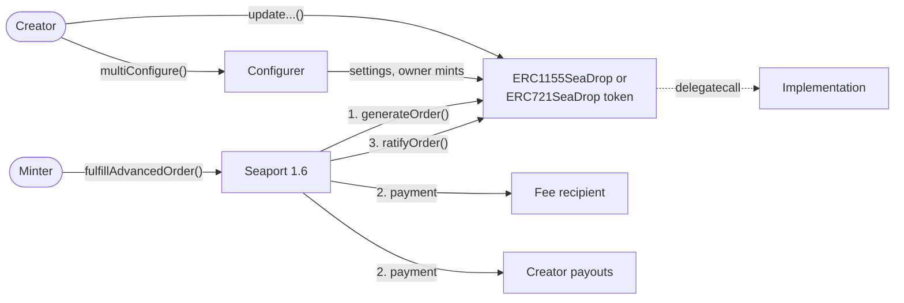

[![Version][version-badge]][version-link]
[![Test CI][ci-badge]][ci-link]
[![Code Coverage][coverage-badge]][coverage-link]
[![License][license-badge]][license-link]
[![Docs][docs-badge]][docs-link]
[![Discussions][discussions-badge]][discussions-link]

# SeaDrop

SeaDrop is a contract for conducting primary NFT drops on evm-compatible blockchains.

## Table of Contents

- [SeaDrop](#seadrop)
  - [Table of Contents](#table-of-contents)
  - [Background](#background)
  - [Deployments](#deployments)
  - [Diagram](#diagram)
  - [Docs](#docs)
  - [Install](#install)
  - [Usage](#usage)
  - [Audits](#audits)
  - [Contributing](#contributing)
  - [License](#license)

## Background

SeaDrop is a protocol to perform primary drops on evm-compatible blockchains. The types of drops supported are public drops, allow list stages, and server-side signed mints.

SeaDrop v2 tokens are [Seaport][seaport-link] contract offerers. Mints are executed by fulfilling Seaport orders with `OrderType.CONTRACT`.

## Deployments

On OpenSea, SeaDrop v2 from this branch currently powers ERC-1155 open collections, which the collection owner mints. Each is a clone from `ERC1155SeaDropCloneFactory` at [`0x00b19A5200A100e5fc4c9800772f4d002f218400`](https://etherscan.io/address/0x00b19A5200A100e5fc4c9800772f4d002f218400#code), and the owner mints through its configurer. OpenSea drops use SeaDrop v1 from the [`main`](https://github.com/ProjectOpenSea/seadrop/tree/main) branch. Earlier v2 ERC-1155 drops, which mint through Seaport 1.6 orders, are still live, but OpenSea no longer creates v2 drops.

See [Deployments](docs/Deployments.md) for every network, the v1 contracts, and the legacy factories.

## Diagram



The token is the drop: it's a Seaport contract offerer, and a mint is a Seaport order whose offerer is the token. The creator configures the token directly, or in one call through its configurer. A minter fulfills the mint order, a `CONTRACT` order, on Seaport. The token mints to the minter in `generateOrder`, Seaport moves the payment to the fee recipient and the creator payouts, and `ratifyOrder` closes the call. The token delegates its SeaDrop logic to an implementation contract (`ERC1155SeaDropContractOffererImplementation` or its ERC-721 counterpart) to stay under the size limit. ERC-1155 open collections on OpenSea only use owner mints through the configurer.

## Docs

- [Deployments](docs/Deployments.md)
- [SeaDrop Token Deployment](docs/SeaDropTokenDeployment.md)
- [Bring Your Own Token Contract](docs/BringYourOwnTokenContract.md)
- [Provenance Hash](docs/ProvenanceHash.md)

## Install

SeaDrop builds and tests with [Foundry](https://getfoundry.sh). To install Foundry (Linux or macOS):

```bash
curl -L https://foundry.paradigm.xyz | bash
foundryup
```

To clone the repo with its dependencies and compile the contracts:

```bash
git clone --recurse-submodules https://github.com/ProjectOpenSea/seadrop && cd seadrop
./scripts/build_seaport.sh
forge build
```

`build_seaport.sh` loosens Seaport's exact `pragma solidity` pins in the `lib/seaport` working tree and builds the Seaport reference and optimized artifacts that the tests load from `reference-out` and `optimized-out`. Don't commit the resulting `lib/seaport` changes.

Node.js (see `.nvmrc`) is only needed for the formatting and git hook tooling. `npm install` installs [Biome](https://biomejs.dev) and sets up the [lefthook](https://lefthook.dev) pre-commit hook, which runs `forge fmt` and Biome on staged files.

```bash
npm install
```

## Usage

To run the tests:

```bash
forge test
```

To print how many bytes `ERC721SeaDrop` has left under the EIP-170 size limit:

```bash
./scripts/show_headroom.sh
```

To run a gas snapshot:

```bash
forge snapshot
```

Add `-vv` through `-vvvvv` to `forge test` for logs, traces for failing tests, and setup traces. See the [Foundry Book](https://getfoundry.sh/forge/tests/overview) for more.

To run lint checks (`forge fmt --check`, `forge lint`, and Biome):

```bash
npm run lint
```

To fix formatting:

```bash
npm run lint:fix
```

## Audits

SeaDrop was audited after development by [Spearbit](https://spearbit.com/), read the report [here](./assets/spearbit-seadrop-audit.pdf).

## Contributing

Contributions to SeaDrop are welcome by anyone interested in writing more tests, improving readability, optimizing for gas efficiency, or extending the protocol with new features.

When making a pull request, ensure that:

- All tests pass.
- All new code adheres to the style guide:
  - All lint checks pass.
  - Code is thoroughly commented with natspec where relevant.
- If making a change to the contracts:
  - Gas snapshots are provided and demonstrate an improvement (or an acceptable deficit given other improvements).
  - Reference contracts are modified correspondingly if relevant.
  - New Foundry tests are included for all new features or code paths.
- A descriptive summary of the PR has been provided.

## License

[MIT](LICENSE) Copyright 2022 Ozone Networks, Inc.

[version-badge]: https://img.shields.io/github/package-json/v/ProjectOpenSea/seadrop
[version-link]: https://github.com/ProjectOpenSea/seadrop/blob/main/package.json
[ci-badge]: https://github.com/ProjectOpenSea/seadrop/actions/workflows/test.yml/badge.svg
[ci-link]: https://github.com/ProjectOpenSea/seadrop/actions/workflows/test.yml
[coverage-badge]: https://coveralls.io/repos/github/ProjectOpenSea/seadrop/badge.svg?branch=main
[coverage-link]: https://coveralls.io/github/ProjectOpenSea/seadrop?branch=main
[license-badge]: https://img.shields.io/github/license/ProjectOpenSea/seadrop
[license-link]: https://github.com/ProjectOpenSea/seadrop/blob/main/LICENSE
[docs-badge]: https://img.shields.io/badge/SeaDrop-documentation-informational
[docs-link]: https://github.com/ProjectOpenSea/seadrop/tree/main/docs
[discussions-badge]: https://img.shields.io/badge/SeaDrop-discussions-blueviolet
[discussions-link]: https://github.com/ProjectOpenSea/seadrop/discussions
[seaport-link]: https://github.com/ProjectOpenSea/seaport
