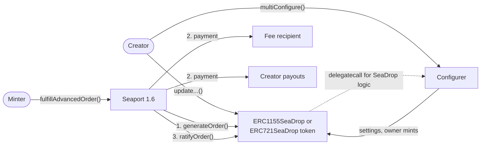

[![Version][version-badge]][version-link]
[![Test CI][ci-badge]][ci-link]
[![Code Coverage][coverage-badge]][coverage-link]
[![License][license-badge]][license-link]
[![Docs][docs-badge]][docs-link]
[![Discussions][discussions-badge]][discussions-link]

# SeaDrop

SeaDrop is a contract for primary NFT drops on EVM chains.

## Background

SeaDrop v2 runs ERC-721 and ERC-1155 drops with public drops, allow lists and server-side signed mints, paid in ETH or ERC-20 tokens. Each token is a [Seaport][seaport-link] contract offerer, so a mint is a Seaport order with `OrderType.CONTRACT`. OpenSea uses v2 for ERC-1155 open collections, and SeaDrop v1 on [`main`](https://github.com/ProjectOpenSea/seadrop/tree/main) for ERC-721 drops.

## Deployments

On OpenSea, SeaDrop v2 from this branch currently powers ERC-1155 open collections, which the collection owner mints. Each is a clone from `ERC1155SeaDropCloneFactory` at [`0x00b19A5200A100e5fc4c9800772f4d002f218400`](https://etherscan.io/address/0x00b19A5200A100e5fc4c9800772f4d002f218400#code), and the owner mints through its configurer. OpenSea drops use SeaDrop v1 from the [`main`](https://github.com/ProjectOpenSea/seadrop/tree/main) branch. Earlier v2 ERC-1155 drops, which mint through Seaport 1.6 orders, are still live, but OpenSea no longer creates v2 drops.

See [Deployments](docs/Deployments.md) for every network, the v1 contracts, and the legacy factories.

## Diagram



The token is the drop: it's a Seaport contract offerer, and a mint is a Seaport order whose offerer is the token. The creator configures the token directly, or in one call through its configurer. A minter fulfills the mint order, a `CONTRACT` order, on Seaport. The token mints to the minter in `generateOrder`, Seaport moves the payment to the fee recipient and the creator payouts, and `ratifyOrder` closes the call. The configurer is also the token's implementation: to stay under the size limit, the token delegatecalls it for its SeaDrop logic. ERC-1155 open collections on OpenSea only use owner mints through the configurer.

## Docs

- [Deployments](docs/Deployments.md)
- [Development](docs/Development.md)
- [SeaDrop Token Deployment](docs/SeaDropTokenDeployment.md)
- [Bring Your Own Token Contract](docs/BringYourOwnTokenContract.md)
- [Provenance Hash](docs/ProvenanceHash.md)

## Development

```bash
git clone --recurse-submodules https://github.com/ProjectOpenSea/seadrop -b v2 && cd seadrop
./scripts/build_seaport.sh
forge build
forge test
```

[Development](docs/Development.md) covers installing Foundry, the Seaport build, coverage, linting, size checks and what a pull request needs.

## Audits

[Spearbit](https://spearbit.com/) audited SeaDrop. Read [the report](./assets/spearbit-seadrop-audit.pdf).

## Contributing

Contributions to SeaDrop are welcome by anyone interested in writing more tests, improving readability, optimizing for gas efficiency, or extending the protocol with new features.

When making a pull request, ensure that:

- All tests pass.
- All new code adheres to the style guide:
  - All lint checks pass.
  - Code is thoroughly commented with natspec where relevant.
- If making a change to the contracts:
  - Gas snapshots are provided and demonstrate an improvement (or an acceptable deficit given other improvements).
  - Reference contracts are modified correspondingly if relevant.
  - New Foundry tests are included for all new features or code paths.
- A descriptive summary of the PR has been provided.

## License

[MIT](LICENSE) Copyright 2022 Ozone Networks, Inc.

[version-badge]: https://img.shields.io/badge/version-2.0.0-blue
[version-link]: https://github.com/ProjectOpenSea/seadrop/tree/v2
[ci-badge]: https://github.com/ProjectOpenSea/seadrop/actions/workflows/test.yml/badge.svg
[ci-link]: https://github.com/ProjectOpenSea/seadrop/actions/workflows/test.yml
[coverage-badge]: https://coveralls.io/repos/github/ProjectOpenSea/seadrop/badge.svg?branch=main
[coverage-link]: https://coveralls.io/github/ProjectOpenSea/seadrop?branch=main
[license-badge]: https://img.shields.io/github/license/ProjectOpenSea/seadrop
[license-link]: https://github.com/ProjectOpenSea/seadrop/blob/main/LICENSE
[docs-badge]: https://img.shields.io/badge/SeaDrop-documentation-informational
[docs-link]: https://github.com/ProjectOpenSea/seadrop/tree/main/docs
[discussions-badge]: https://img.shields.io/badge/SeaDrop-discussions-blueviolet
[discussions-link]: https://github.com/ProjectOpenSea/seadrop/discussions
[seaport-link]: https://github.com/ProjectOpenSea/seaport
