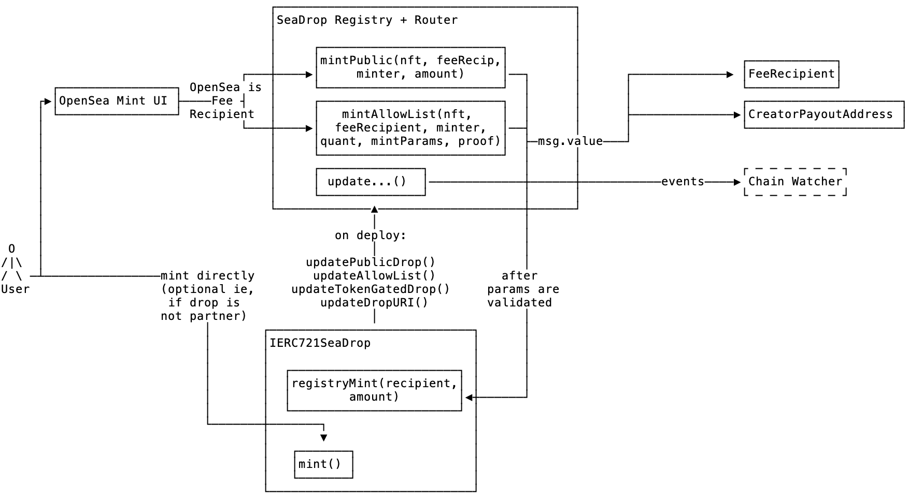

[![Version][version-badge]][version-link]
[![Test CI][ci-badge]][ci-link]
[![Code Coverage][coverage-badge]][coverage-link]
[![License][license-badge]][license-link]
[![Docs][docs-badge]][docs-link]
[![Discussions][discussions-badge]][discussions-link]

# SeaDrop

SeaDrop is a contract for conducting primary NFT drops on evm-compatible blockchains.

## Table of Contents

- [SeaDrop](#seadrop)
  - [Table of Contents](#table-of-contents)
  - [Background](#background)
  - [Deployments](#deployments)
  - [Diagram](#diagram)
  - [Docs](#docs)
  - [Install](#install)
  - [Usage](#usage)
  - [Audits](#audits)
  - [Contributing](#contributing)
  - [License](#license)

## Background

SeaDrop is a contract to perform primary drops on evm-compatible blockchains. The types of drops supported are public drops, allow list stages, token gated drops, and server-side signed mints. An implementing token contract should contain the methods to interface with `SeaDrop` through an authorized user such as an Owner or Administrator.

Future SeaDrop contracts are envisioned to contain additional functionality like descending dutch auction mechanisms and payment in ERC20 tokens.

## Deployments

`SeaDrop` 1.0 is deployed at [`0x00005EA00Ac477B1030CE78506496e8C2dE24bf5`](https://etherscan.io/address/0x00005EA00Ac477B1030CE78506496e8C2dE24bf5#code) on Ethereum and most other networks OpenSea supports. On OpenSea, SeaDrop v1 from this branch powers drops. SeaDrop v2, on the [`v2`](https://github.com/ProjectOpenSea/seadrop/tree/v2) branch, currently powers ERC-1155 open collections, which the collection owner mints.

See [Deployments](docs/Deployments.md) for the clone factories, every network, and the legacy contracts. To deploy to a new network, follow [SeaDrop Deployment](docs/SeaDropDeployment.md).

## Diagram



This diagram shows the logic flow in the case that a drop is hosted on OpenSea, with an optional mint hosted elsewhere. Note that a fee recipient is not required to integrate with SeaDrop, and a fee recipient may be any address.

## Docs

- [Deployments](docs/Deployments.md)
- [SeaDrop Deployment](docs/SeaDropDeployment.md)
- [SeaDrop Token Deployment](docs/SeaDropTokenDeployment.md)
- [Bring Your Own Token Contract](docs/BringYourOwnTokenContract.md)
- [Provenance Hash](docs/ProvenanceHash.md)
- [Upgradeable Contracts](docs/UpgradeableContracts.md)

## Install

SeaDrop builds and tests with [Foundry](https://getfoundry.sh). To install Foundry (Linux or macOS):

```bash
curl -L https://foundry.paradigm.xyz | bash
foundryup
```

To clone the repo with its dependencies and compile the contracts:

```bash
git clone --recurse-submodules https://github.com/ProjectOpenSea/seadrop && cd seadrop
forge build
```

Node.js (see `.nvmrc`) is only needed for the formatting and git hook tooling. `npm install` installs [Biome](https://biomejs.dev) and sets up the [lefthook](https://lefthook.dev) pre-commit hook, which runs `forge fmt` and Biome on staged files.

```bash
npm install
```

## Usage

To run the tests:

```bash
forge test
```

This runs the upgradeable contracts' tests too. `src/upgradeable` compiles with its deployable settings (via-IR, 1000 optimizer runs) in the same build; see [Upgradeable Contracts](docs/UpgradeableContracts.md).

To run coverage:

```bash
npm run coverage
```

To run a gas snapshot:

```bash
forge snapshot
```

Add `-vv` through `-vvvvv` to `forge test` for logs, traces for failing tests, and setup traces. See the [Foundry Book](https://getfoundry.sh/forge/tests/overview) for more.

To run lint checks (`forge fmt --check`, `forge lint`, and Biome):

```bash
npm run lint
```

To fix formatting:

```bash
npm run lint:fix
```

## Audits

SeaDrop was audited after development by [Spearbit](https://spearbit.com/), read the report [here](./assets/spearbit-seadrop-audit.pdf).

## Contributing

Contributions to SeaDrop are welcome by anyone interested in writing more tests, improving readability, optimizing for gas efficiency, or extending the protocol with new features.

When making a pull request, ensure that:
- All tests pass.
- Code coverage remains at 100%.
- All new code adheres to the style guide:
  - All lint checks pass.
  - Code is thoroughly commented with natspec where relevant.
- If making a change to the contracts:
  - Gas snapshots are provided and demonstrate an improvement (or an acceptable deficit given other improvements).
  - Reference contracts are modified correspondingly if relevant.
  - New Foundry tests are included for all new features or code paths.
- A descriptive summary of the PR has been provided.

## License

[MIT](LICENSE) Copyright 2022 Ozone Networks, Inc.

[version-badge]: https://img.shields.io/github/package-json/v/ProjectOpenSea/seadrop
[version-link]: https://github.com/ProjectOpenSea/seadrop/blob/main/package.json
[ci-badge]: https://github.com/ProjectOpenSea/seadrop/actions/workflows/test.yml/badge.svg
[ci-link]: https://github.com/ProjectOpenSea/seadrop/actions/workflows/test.yml
[coverage-badge]: https://coveralls.io/repos/github/ProjectOpenSea/seadrop/badge.svg?branch=main
[coverage-link]: https://coveralls.io/github/ProjectOpenSea/seadrop?branch=main
[license-badge]: https://img.shields.io/github/license/ProjectOpenSea/seadrop
[license-link]: https://github.com/ProjectOpenSea/seadrop/blob/main/LICENSE
[docs-badge]: https://img.shields.io/badge/SeaDrop-documentation-informational
[docs-link]: https://github.com/ProjectOpenSea/seadrop/tree/main/docs
[discussions-badge]: https://img.shields.io/badge/SeaDrop-discussions-blueviolet
[discussions-link]: https://github.com/ProjectOpenSea/seadrop/discussions
