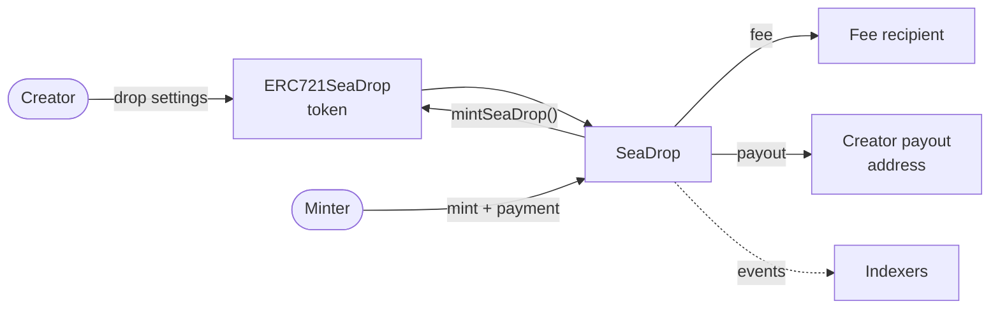

[![Version][version-badge]][version-link]
[![Test CI][ci-badge]][ci-link]
[![Code Coverage][coverage-badge]][coverage-link]
[![License][license-badge]][license-link]
[![Docs][docs-badge]][docs-link]
[![Discussions][discussions-badge]][discussions-link]

# SeaDrop

SeaDrop is a contract for primary NFT drops on EVM chains.

## Background

SeaDrop runs primary NFT drops: public drops, allow lists, server-side signed mints and token-gated mints. A token contract configures its drop through `SeaDrop`, and minters mint through `SeaDrop`.

This branch is SeaDrop v1, which powers OpenSea's ERC-721 drops. [SeaDrop v2](https://github.com/ProjectOpenSea/seadrop/tree/v2) adds ERC-1155 tokens, ERC-20 payments and several public stages per token, and powers OpenSea's ERC-1155 open collections.

## Deployments

`SeaDrop` 1.0 is at [`0x00005EA00Ac477B1030CE78506496e8C2dE24bf5`](https://etherscan.io/address/0x00005EA00Ac477B1030CE78506496e8C2dE24bf5#code) on Ethereum and most networks OpenSea supports. [Deployments](docs/Deployments.md) lists every network, the clone factories and the legacy contracts, and [SeaDrop Deployment](docs/SeaDropDeployment.md) covers a new network.

## Diagram



The creator configures a drop by calling the token, for example `updatePublicDrop()` or `multiConfigure()`, and the token forwards the settings to `SeaDrop`. A minter calls `SeaDrop` with the payment, through `mintPublic()`, `mintSigned()`, `mintAllowList()` or `mintAllowedTokenHolder()`. `SeaDrop` checks the stage, the wallet limit and the max supply, pays the fee recipient and the creator's payout address, and calls `mintSeaDrop()` on the token. Every mint names a fee recipient, which can't be the zero address. When a drop restricts fee recipients, it must be one the token allows. The fee itself can be zero.

## Docs

- [Deployments](docs/Deployments.md)
- [SeaDrop Deployment](docs/SeaDropDeployment.md)
- [SeaDrop Token Deployment](docs/SeaDropTokenDeployment.md)
- [Bring Your Own Token Contract](docs/BringYourOwnTokenContract.md)
- [Provenance Hash](docs/ProvenanceHash.md)
- [Upgradeable Contracts](docs/UpgradeableContracts.md)

## Development

```bash
git clone --recurse-submodules https://github.com/ProjectOpenSea/seadrop && cd seadrop
forge build
forge test
```

[Development](docs/Development.md) covers installing Foundry, coverage, gas snapshots, linting, size checks and what a pull request needs.

## Audits

[Spearbit](https://spearbit.com/) audited SeaDrop. Read [the report](./assets/spearbit-seadrop-audit.pdf).

## Contributing

Contributions to SeaDrop are welcome by anyone interested in writing more tests, improving readability, optimizing for gas efficiency, or extending the protocol with new features.

When making a pull request, ensure that:

- All tests pass.
- Code coverage remains at 100%.
- All new code adheres to the style guide:
  - All lint checks pass.
  - Code is thoroughly commented with natspec where relevant.
- If making a change to the contracts:
  - Gas snapshots are provided and demonstrate an improvement (or an acceptable deficit given other improvements).
  - Reference contracts are modified correspondingly if relevant.
  - New Foundry tests are included for all new features or code paths.
- A descriptive summary of the PR has been provided.

## License

[MIT](LICENSE) Copyright 2022 Ozone Networks, Inc.

[version-badge]: https://img.shields.io/github/package-json/v/ProjectOpenSea/seadrop
[version-link]: https://github.com/ProjectOpenSea/seadrop/blob/main/package.json
[ci-badge]: https://github.com/ProjectOpenSea/seadrop/actions/workflows/test.yml/badge.svg
[ci-link]: https://github.com/ProjectOpenSea/seadrop/actions/workflows/test.yml
[coverage-badge]: https://coveralls.io/repos/github/ProjectOpenSea/seadrop/badge.svg?branch=main
[coverage-link]: https://coveralls.io/github/ProjectOpenSea/seadrop?branch=main
[license-badge]: https://img.shields.io/github/license/ProjectOpenSea/seadrop
[license-link]: https://github.com/ProjectOpenSea/seadrop/blob/main/LICENSE
[docs-badge]: https://img.shields.io/badge/SeaDrop-documentation-informational
[docs-link]: https://github.com/ProjectOpenSea/seadrop/tree/main/docs
[discussions-badge]: https://img.shields.io/badge/SeaDrop-discussions-blueviolet
[discussions-link]: https://github.com/ProjectOpenSea/seadrop/discussions
