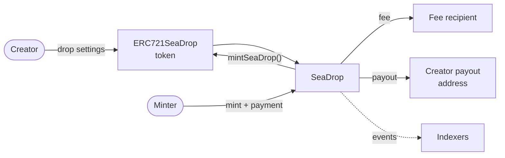

# SeaDrop v1

The original SeaDrop minter runs ERC-721 drops. Collections configure the shared minter through their token contract.

## Deployments

`SeaDrop` 1.0 is at [`0x00005EA00Ac477B1030CE78506496e8C2dE24bf5`](https://etherscan.io/address/0x00005EA00Ac477B1030CE78506496e8C2dE24bf5#code) on Ethereum and most networks OpenSea supports. [Deployments](Deployments.md) lists every network, the clone factories and the legacy contracts, and [SeaDrop Deployment](SeaDropDeployment.md) covers a new network.

## Mint flow

The creator configures a drop by calling the token, for example `updatePublicDrop()` or `multiConfigure()`, and the token forwards the settings to `SeaDrop`. A minter calls `SeaDrop` with the payment, through `mintPublic()`, `mintSigned()`, `mintAllowList()` or `mintAllowedTokenHolder()`. `SeaDrop` checks the stage, the wallet limit and the max supply, pays the fee recipient and the creator's payout address, and calls `mintSeaDrop()` on the token. Every mint names a fee recipient, which can't be the zero address. When a drop restricts fee recipients, it must be one the token allows. The fee itself can be zero.

## Docs

- [Deployments](Deployments.md)
- [SeaDrop Deployment](SeaDropDeployment.md)
- [SeaDrop Token Deployment](SeaDropTokenDeployment.md)
- [Bring Your Own Token Contract](BringYourOwnTokenContract.md)
- [Agent NFTs](AgentNFTs.md)
- [Drops for an existing contract](ExistingContractAdapters.md)
- [Provenance Hash](ProvenanceHash.md)
- [Upgradeable Contracts](UpgradeableContracts.md)
