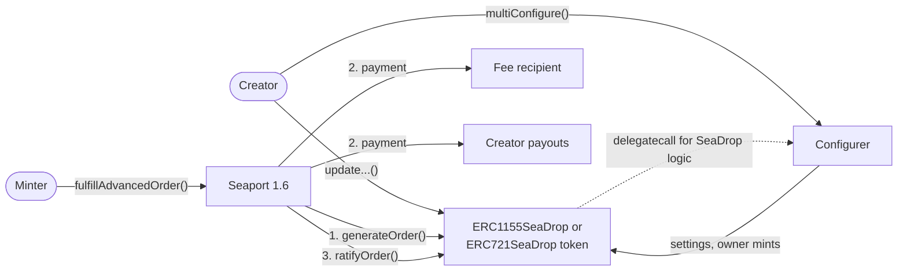

# SeaDrop v2

SeaDrop v2 runs ERC-721 and ERC-1155 drops with public drops, allow lists and server-side signed mints, paid in ETH or ERC-20 tokens. Each token is a [Seaport](https://github.com/ProjectOpenSea/seaport) contract offerer, so a mint is a Seaport order with `OrderType.CONTRACT`. OpenSea uses v2 for ERC-1155 open collections, and [v1](../../docs/SeaDropV1.md) for ERC-721 drops.

## Deployments

On OpenSea, SeaDrop v2 currently powers ERC-1155 open collections, which the collection owner mints. Each is a clone from `ERC1155SeaDropCloneFactory` at [`0x00b19A5200A100e5fc4c9800772f4d002f218400`](https://etherscan.io/address/0x00b19A5200A100e5fc4c9800772f4d002f218400#code), and the owner mints through its configurer. Earlier v2 ERC-1155 drops, which mint through Seaport 1.6 orders, are still live, but OpenSea no longer creates these Seaport-based drops.

See [Deployments](../../docs/Deployments.md) for every network, the v1 contracts, and the legacy factories.

## Diagram

The token is the drop: it's a Seaport contract offerer, and a mint is a Seaport order whose offerer is the token. The creator configures the token directly, or in one call through its configurer. A minter fulfills the mint order, a `CONTRACT` order, on Seaport. The token mints to the minter in `generateOrder`, Seaport moves the payment to the fee recipient and the creator payouts, and `ratifyOrder` closes the call. The configurer is also the token's implementation: to stay under the size limit, the token delegatecalls it for its SeaDrop logic. ERC-1155 open collections on OpenSea only use owner mints through the configurer.

## Docs

- [Deployments](../../docs/Deployments.md)
- [Development](../../docs/Development.md#seadrop-v2)
- [SeaDrop Token Deployment](docs/SeaDropTokenDeployment.md)
- [Bring Your Own Token Contract](docs/BringYourOwnTokenContract.md)
- [Provenance Hash](../../docs/ProvenanceHash.md)
